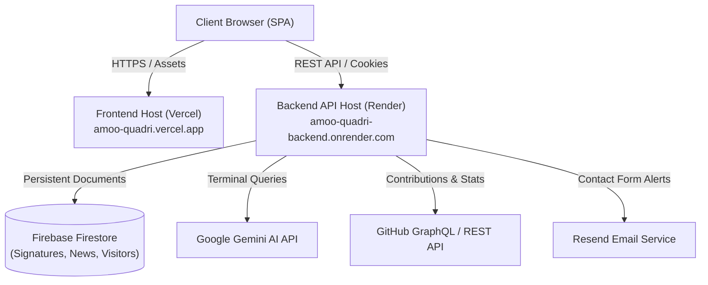

# Amoo Quadri Ayomikun — Portfolio & Research Portal

[](https://github.com/AmooAyomikun/Amoo-Quadri-Ayomikun-Portfolio/actions/workflows/ci.yml)
[](https://vitejs.dev/)
[](https://react.dev/)
[](https://www.typescriptlang.org/)
[](https://nodejs.org/)
[](https://opensource.org/licenses/MIT)

> A modern, accessible, full-stack personal portfolio, academic research showcase, and interactive engineering platform for **Quadri Ayomikun Amoo** (First-Class Honours Computer Science graduate, AI researcher, and Full-Stack Software Engineer).

---

## 🏛 Architecture Overview

This repository is structured as an **npm workspace monorepo** containing the client-side SPA, the server-side REST API, and shared type definitions:



### Monorepo Structure

```text
.
├── .github/
│   └── workflows/
│       └── ci.yml               # GitHub Actions CI (Typecheck, Lint, Tests, Build)
├── backend/                     # Node.js + Express REST API
│   ├── scripts/                 # Administrative & maintenance utilities
│   ├── src/
│   │   ├── config/              # Environment schema validation & Firebase init
│   │   ├── controllers/         # HTTP request handlers
│   │   ├── middleware/          # Security (Helmet, CORS, rate-limiting, admin auth)
│   │   ├── repositories/        # Firestore & file persistence layer
│   │   ├── routes/              # Express API route modules
│   │   ├── schemas/             # Zod input validation schemas
│   │   └── services/            # Business logic (AI chat, GitHub, email, news)
│   ├── .env.example             # Backend environment template
│   └── tsconfig.json
├── frontend/                    # Vite + React 18 + Tailwind CSS SPA
│   ├── e2e/                     # Playwright end-to-end smoke tests
│   ├── public/                  # Static assets & dynamic sitemap.xml
│   ├── scripts/
│   │   ├── check-confirms.mjs   # Build-time verification & env check
│   │   ├── generate-sitemap.mjs # Build-time dynamic sitemap generation
│   │   └── prerender-meta.mjs   # Route-level static HTML prerendering for crawlers
│   ├── src/
│   │   ├── components/          # Reusable UI elements (PageContainer, SEO, Terminal, etc.)
│   │   ├── content/             # Structured resume, project & research data
│   │   ├── hooks/               # Custom hooks (useApi, useVisitorStats, useBackendKeepAlive)
│   │   ├── pages/               # Routed views
│   │   └── sections/            # Modular home sections
│   ├── .env.example             # Frontend environment template
│   └── vite.config.ts
├── shared/                      # Shared types & CV data contracts
├── package.json                 # Monorepo workspace orchestration
└── README.md
```

---

## ⚡ Tech Stack

| Domain | Technologies |
| :--- | :--- |
| **Frontend** | React 18, TypeScript, Vite, Tailwind CSS, Framer Motion, Lucide Icons, Canvas API |
| **Backend** | Node.js, Express, TypeScript, Firebase Admin SDK (Firestore), Helmet, Compression, Zod |
| **Testing** | Vitest, React Testing Library, Supertest, Node Test Runner, Playwright, axe-core |
| **Tooling & CI** | Oxlint, GitHub Actions, npm workspaces |
| **Deployment** | Vercel (Frontend SPA), Render (Backend API) |

---

## ✨ Key Features

1. **Interactive Visitor Map & Leaderboard**:
   - Real-time country/city telemetry with hashed IPs and privacy-safe storage.
   - Fallback SVG world projection with zero external map tiles required.
2. **AI Interactive Terminal**:
   - Terminal emulator querying Quadri's bio, tech stack, and research publications.
   - Powered by Google Gemini with built-in heuristic offline fallbacks.
3. **Digital Signature Guestbook**:
   - In-browser HTML5 canvas signature capture with stroke persistence across resize events.
   - Firestore pagination, cursor-based loading, and automated profanity filtering.
4. **SSRF-Safe Proxy & GitHub Heatmap**:
   - Secure server-side proxy blocking private IP ranges and unauthorized hosts.
   - Dual-mode GitHub contribution graph fetching via GraphQL with REST fallback.
5. **SEO & Social Preview Prerendering**:
   - Build-time sitemap generator omitting redirected/private paths.
   - Static HTML route pre-rendering generating tailored OpenGraph, Twitter Cards, and canonical tags for LinkedIn, WhatsApp, X, and search engine crawlers.
6. **Render Cold-Start UX**:
   - Automatic background `/api/health` keep-alive pinging on load and every 10 minutes.
   - Skeleton states and informative "Waking Server" indicators to eliminate perceived freezing.

---

## 🚀 Getting Started

### Prerequisites

- **Node.js**: `v20.0.0` or higher
- **npm**: `v10.0.0` or higher

### 1. Clone the Repository

```bash
git clone https://github.com/AmooAyomikun/Amoo-Quadri-Ayomikun-Portfolio.git
cd Amoo-Quadri-Ayomikun-Portfolio
```

### 2. Install Dependencies

Install all dependencies across all monorepo workspaces:

```bash
npm install
```

### 3. Environment Configuration

Copy the example environment templates:

```bash
# Frontend configuration
cp frontend/.env.example frontend/.env

# Backend configuration
cp backend/.env.example backend/.env
```

#### Frontend Variables (`frontend/.env`)

| Variable | Description | Default (Local) |
| :--- | :--- | :--- |
| `VITE_API_URL` | Base URL of the backend API | `http://localhost:5000` |
| `VITE_SITE_URL` | Canonical public URL of the frontend | `https://amoo-quadri.vercel.app` |

#### Backend Variables (`backend/.env`)

| Variable | Description |
| :--- | :--- |
| `PORT` | Local server port (default: `5000`) |
| `NODE_ENV` | Runtime environment (`development`, `test`, `production`) |
| `ALLOWED_ORIGINS` | Comma-delimited list of origins permitted by CORS |
| `ADMIN_PASSWORD` | Passphrase used to access the `/admin` portal |
| `ADMIN_TOKEN_SECRET`| Secret used to sign administrative JWT cookies (min 32 chars) |
| `VISITOR_SALT` | Secret salt used to hash visitor IP addresses (min 16 chars) |
| `GEMINI_API_KEY` | *(Optional)* Google Gemini API key for visitor terminal responses |
| `GITHUB_TOKEN` | *(Optional)* GitHub personal access token for higher GraphQL rate limits |
| `RESEND_API_KEY` | *(Optional)* Resend API key for contact form email alerts |

### 4. Running Locally

Start both the frontend client and backend server concurrently:

```bash
npm run dev:all
```

Or run individual services:

```bash
# Run frontend only (http://localhost:5173)
npm run dev --prefix frontend

# Run backend only (http://localhost:5000)
npm run dev --prefix backend
```

---

## 🧪 Testing & Quality Assurance

The codebase includes comprehensive unit, integration, and end-to-end tests:

```bash
# Run all frontend and backend tests
npm test

# Run frontend tests with Vitest (25 unit & RTL tests)
npm run test:frontend

# Run backend integration tests (33 tests covering routes, auth, schemas, SSRF)
npm run test:backend

# Run linter
npm run lint

# Run type check
npm run build:backend && npx tsc -b frontend/tsconfig.app.json

# Run end-to-end smoke tests (requires dev server running)
cd frontend && npx playwright test
```

---

## 📦 Production Build & Deployment

To verify and generate production builds:

```bash
npm run build
```

This executes:
1. `check-confirms.mjs`: Verifies `VITE_API_URL` and ensures no temporary markers exist.
2. `tsc -b`: Compiles TypeScript cleanly.
3. `vite build`: Emits optimized assets to `frontend/dist/`.
4. `generate-sitemap.mjs`: Generates canonical `sitemap.xml` with dynamic `lastmod`.
5. `prerender-meta.mjs`: Generates static HTML shells for all 14 routes with OpenGraph tags.
6. `backend/build`: Compiles backend TypeScript to `backend/dist/`.

### Deployment Targets

- **Frontend**: Hosted on [Vercel](https://vercel.com/) with root directory set to `frontend` or build output configured for `frontend/dist`.
- **Backend**: Hosted on [Render](https://render.com/) as a Web Service running `npm run start --prefix backend`.

---

## 📋 Engineering Audit & Quality Improvements

A comprehensive architectural audit was conducted across the codebase to ensure enterprise-grade security, accessibility, reliability, and code hygiene. For full technical details and rationales:

👉 See [Engineering Audit Log](docs/AUDIT_LOG.md) for detailed breakdowns of issues 1.1 through 6.5.

---

## 📄 License

This project is open-source software licensed under the [MIT License](LICENSE).
